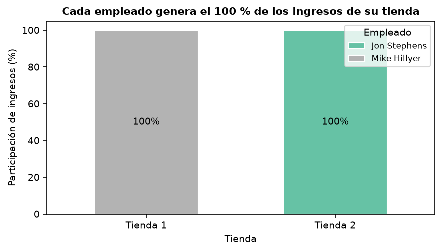
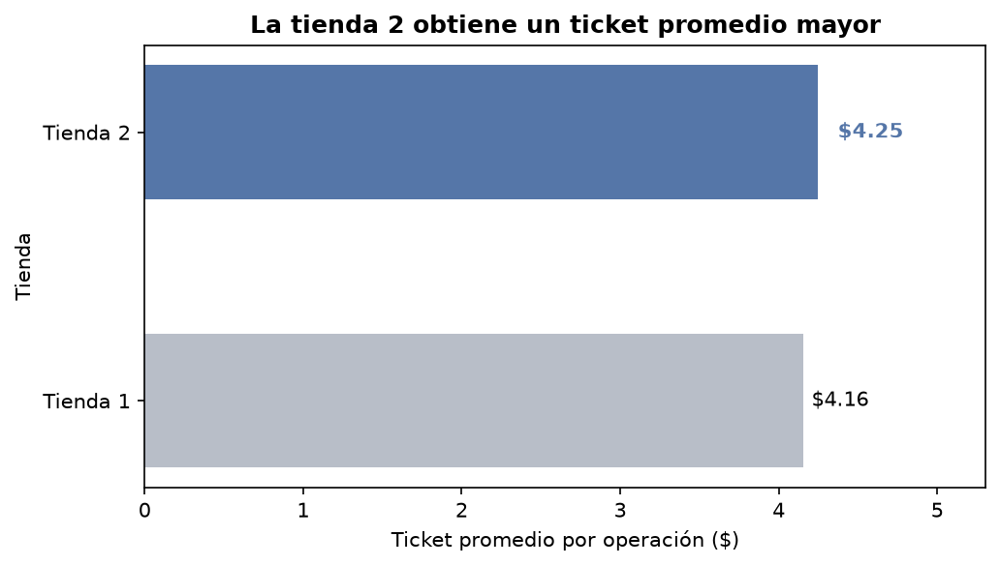
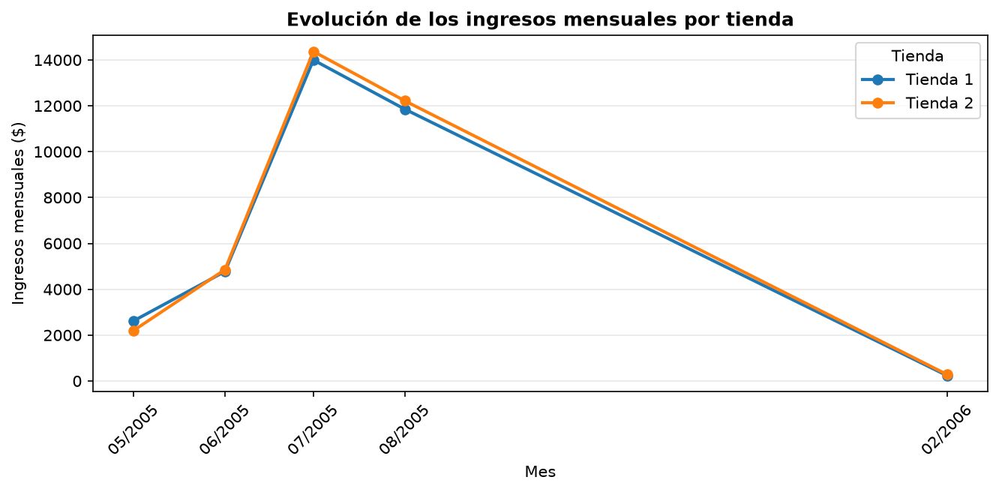

borador informe

Actividad 0 – Preparación, conexión y reconciliación

Objetivo

Se nos pidió entorno de trabajo en Python para analizar la base de datos Sakila anteriormente migrada de MySQL a SQL Server, centralizar las equivalencias de nombres mediante un diccionario y verificar las cantidades de registros después de la migración.

Tecnologías utilizadas

- Python 3.12
- SQL Server en Docker
- Visual Studio Code
- mssql-python
- python-dotenv
- Pandas y otras bibliotecas incluidas en requirements.txt

Estructura del proyecto

- conexion.py: prueba la conexión a SQL Server.
- esquema.py: contiene el diccionario que relaciona los nombres canónicos de Sakila con los nombres físicos de la base migrada.
- conteo_mysql.py: analiza las inserciones del archivo original sakila-data.sql y genera conteo_origen_mysql.csv.
- reconciliacion.py: consulta los registros de SQL Server, los compara con los recuentos de origen y genera reconciliacion_final.csv.
- validar_esquema.py: comprueba que las columnas registradas en el diccionario existan en SQL Server.
- requirements.txt: dependencias de Python.
- .env: configuración privada de conexión; no debe subirse al repositorio.
- sakila-data.sql y sakila-schema.sql: archivos originales de Sakila utilizados como referencia.

Configuración

Crear un entorno virtual de Python e instalar las dependencias:


python3.12 -m venv .venv
source .venv/bin/activate
python -m pip install -r requirements.txt

Crear un archivo .env con las variables:

env
DB_SERVER=localhost
DB_PORT=1433
DB_NAME=Sakila_Espanol
DB_USER=sa
DB_PASSWORD=TU_CONTRASENA (la contraseña real debe mantenerse fuera del código fuente y de GitHub)

La conexión actual utiliza autenticación de SQL Server con usuario y contraseña. Para un entorno Windows con autenticación integrada, será necesario adaptar el método de conexión.

Ejecución

Los siguientes comandos deben ejecutarse desde la carpeta raíz del proyecto, con SQL Server iniciado y la base de datos configurada en .env.

1. Activar el entorno virtual

En macOS:
source .venv/bin/activate


2. Configurar OpenSSL en macOS**

En el equipo Mac utilizado para el desarrollo, mssql-python requiere indicar la ubicación de las bibliotecas de Python 3.12:

export DYLD_LIBRARY_PATH=/Library/Frameworks/Python.framework/Versions/3.12/lib

Este comando debe ejecutarse cada vez que se abre una terminal nueva, antes de utilizar los scripts que se conectan a SQL Server.

3. Generar el conteo del origen MySQL**

python conteo_mysql.py

Genera el archivo conteo_origen_mysql.csv a partir de sakila-data.sql.

4. Verificar la conexión con SQL Server**

python conexion.py


Resultado esperado:

¡Conexión exitosa! Base de datos: Sakila_Espanol

5. Ejecutar la reconciliación**

python reconciliacion.py


Compara las 16 tablas y genera reconciliacion_final.csv. En la migración utilizada para el desarrollo, todas las diferencias fueron cero.

6. Validar las columnas del diccionario**

python validar_esquema.py

Resultado esperado en la migración utilizada:

Columnas faltantes: 0

**Importante:** los comandos deben ejecutarse en el orden indicado. Si se abre una terminal nueva, hay que activar nuevamente el entorno virtual y configurar OpenSSL en macOS antes de ejecutar los programas que consultan SQL Server.

 Resultados de la reconciliación

Se compararon las cantidades de registros de las 16 tablas de Sakila entre los datos originales de MySQL y la base migrada a SQL Server.

Inicialmente, los recuentos de origen se obtuvieron analizando las instrucciones INSERT del archivo sakila-data.sql, mediante el programa conteo_mysql.py.

Las 15 tablas con inserciones directas en el archivo original presentaron la misma cantidad de registros en SQL Server, con diferencia cero.

 Verificación de la tabla film_text

La tabla film_text presenta una particularidad: el archivo sakila-data.sql no contiene instrucciones INSERT directas para esta tabla.

Esto se debe a que el esquema original de Sakila incluye un trigger denominado ins_film, definido en sakila-schema.sql, que inserta automáticamente un registro en film_text cada vez que se agrega una película a la tabla film.

Inicialmente, a partir de las 1.000 películas y del funcionamiento del trigger, se estableció un recuento esperado de 1.000 registros.

Posteriormente, para comprobar esta cantidad sin depender únicamente de la deducción, se utilizó MySQL Workbench y se ejecutó una consulta directamente sobre una base MySQL con los datos de Sakila cargados:

sql
SELECT COUNT(*) AS cantidad
FROM sakila.film_text;

Resultado obtenido en MySQL: 1.000 registros.

En la base migrada a SQL Server se verificó la cantidad de registros de la tabla equivalente, pelicula_texto, mediante la consulta:

sql
SELECT COUNT(*) AS cantidad
FROM pelicula_texto;

Resultado obtenido en SQL Server: 1.000 registros.

Por lo tanto, se confirmó mediante consultas a las bases de datos que ambas tablas contienen 1.000 registros, con una diferencia de cero.

Esta comprobación complementa el análisis realizado sobre los archivos originales y permite validar directamente el recuento de film_text en MySQL.

 Archivo de reconciliación

Los resultados se guardan en reconciliacion_final.csv, generado mediante reconciliacion.py, con las siguientes columnas:

- Tabla: nombre canónico de la tabla original de Sakila.
- Filas de origen: cantidad obtenida a partir de los datos originales de MySQL.
- Filas de SQL Server: cantidad consultada directamente en la base migrada.
- Diferencia: resta entre las cantidades de SQL Server y del origen.

Las 16 tablas presentan una diferencia de cero registros.

Los recuentos de origen de las 15 tablas con inserciones directas provienen del análisis del archivo SQL original. Para film_text, además del recuento esperado por el trigger, se realizó una verificación directa en MySQL Workbench.

 Diccionario de esquema y portabilidad

El archivo esquema.py centraliza las equivalencias entre los nombres canónicos de las tablas y columnas de Sakila y los nombres físicos utilizados en la migración a SQL Server.

Por ejemplo:

| Nombre original de Sakila | Nombre en SQL Server |
| payment | pago |

El diccionario permite que los programas trabajen con los nombres originales de Sakila y obtengan los nombres físicos correspondientes mediante las funciones definidas en esquema.py.

Las consultas desarrolladas deben utilizar estas funciones para resolver los nombres físicos de las tablas y columnas, evitando escribirlos directamente en otros archivos.

Esto tiene como objetivo facilitar la adaptación del proyecto a otras migraciones de Sakila que utilicen nombres diferentes.
Por ejemplo, si otro equipo conserva la tabla payment con su nombre original en lugar de utilizar pago, se modifica la equivalencia correspondiente en esquema.py, sin necesidad de cambiar la lógica de las consultas.

 Validación del esquema

Se desarrolló y ejecutó el programa validar_esquema.py, que verifica la correspondencia entre los nombres físicos de columnas registrados en esquema.py y las columnas existentes en SQL Server.

Para realizar esta comprobación, el programa consulta la vista INFORMATION_SCHEMA.COLUMNS de SQL Server.

Posteriormente, compara los nombres obtenidos con las columnas definidas en el diccionario.
Esta comprobación permite verificar que los nombres físicos de columnas definidos en esquema.py existen en la base migrada. Sin embargo, no garantiza por sí sola que todas las equivalencias sean semánticamente correctas.

 Conclusión

Durante la Actividad 0 se preparó el entorno de trabajo en Python, se configuró la conexión con SQL Server y se implementó un diccionario de equivalencias entre los nombres originales de Sakila y los nombres físicos de la base migrada.
Se desarrollaron programas para obtener los recuentos del origen MySQL, consultar las cantidades de registros en SQL Server, generar un archivo CSV de reconciliación y validar los nombres de las columnas.
La reconciliación realizada sobre las 16 tablas presentó una diferencia de cero registros.
En particular, se investigó el funcionamiento de la tabla film_text y su trigger ins_film. Posteriormente, se comprobó directamente mediante MySQL Workbench que la tabla contenía 1.000 registros en una base MySQL con datos de Sakila, coincidiendo con los 1.000 registros encontrados en SQL Server.
La coincidencia de cantidades permite verificar la consistencia de los recuentos, aunque no garantiza por sí sola que todos los valores de los registros migrados sean idénticos.
Finalmente, la validación del esquema confirmó que las columnas físicas registradas en el diccionario existen en SQL Server, sin detectar columnas faltantes.


 Actividad 1 – Extracción y análisis del rendimiento comercial

 Objetivo

Analizar el rendimiento comercial por tienda y por empleado utilizando la base de datos Sakila migrada a SQL Server, correspondiente a la variante 5 del trabajo práctico.

El objetivo es obtener las métricas necesarias mediante consultas T-SQL, trasladar los resultados a pandas y comparar los cálculos realizados en ambas herramientas.

 Tecnologías utilizadas

- SQL Server
- Python 3.12
- pandas
- Jupyter Notebook
- Visual Studio Code
- mssql-python

 Archivos desarrollados

- actividad1_consultas.sql: contiene las consultas T-SQL comentadas.
- actividad1_analisis.ipynb: notebook con la extracción de datos, validaciones, comparación de resultados, medición de tiempos y visualizaciones.

 Desarrollo

 1. Extracción optimizada de datos

Se desarrolló una consulta T-SQL que relaciona las tablas "empleado" y "pago" para calcular la cantidad de pagos, los ingresos totales y el ticket promedio por empleado y tienda.

También se utilizaron funciones de ventana para calcular la participación de cada empleado dentro de su tienda y la participación de cada tienda sobre los ingresos totales del negocio.

Las uniones y agregaciones principales se realizaron en SQL Server para evitar trasladar innecesariamente todos los pagos al DataFrame principal.

2. Carga de datos con pandas

Se utilizó pandas.read_sql() para ejecutar la consulta y cargar los resultados agrupados en un DataFrame.

En nuestra consulta principal no utilizamos params porque analizamos todas las tiendas y todos los empleados, sin filtros variables. Si necesitáramos filtrar por tienda o fecha, utilizaríamos consultas parametrizadas para evitar concatenaciones y prevenir inyecciones SQL.

3. Comparación entre SQL Server y pandas

Se calculó una misma métrica de ingresos por tienda y empleado mediante dos enfoques:

- Agregación directamente en SQL Server.
- Agrupación con pandas a partir de los pagos individuales.

Se compararon los resultados para verificar su coincidencia y se midieron los tiempos de ejecución utilizando perf_counter().

Los valores obtenidos coincidieron, sin diferencias en los ingresos calculados.

La comparación de tiempos debe interpretarse considerando que la medición de SQL Server incluye la consulta y transferencia de resultados, mientras que pandas trabaja con datos previamente cargados en memoria.

 4. Controles de calidad

Se verificó la integridad de las relaciones entre pagos y empleados, y se identificaron posibles empleados sin operaciones.

También se realizaron consultas complementarias para analizar la distribución de clientes y la relación de los pagos con ambas tiendas.

 5. Visualizaciones

Se generaron gráficos para representar la participación de los empleados en los ingresos de cada tienda y comparar la recaudación total entre tiendas.

Dado que la base contiene un empleado por tienda, cada empleado representa el 100 % de los ingresos de su tienda en el gráfico de participación interna.

 Resultados obtenidos

| Indicador | Tienda 1 | Tienda 2 |
|---|---:|---:|
| Empleado | Mike Hillyer | Jon Stephens |
| Cantidad de pagos | 8.054 | 7.990 |
| Ingresos totales | $33.482,50 | $33.924,06 |
| Ticket promedio aproximado | $4,16 | $4,25 |
| Participación en el negocio | 49,67 % | 50,33 % |

Ingresos totales del negocio: $67.406,56.

Se analizaron 16.044 pagos. No se encontraron pagos asociados a empleados inexistentes y las métricas de ingresos calculadas en SQL Server y pandas coincidieron.

 Conclusión

La Actividad 1 permitió comprobar que SQL Server y pandas pueden utilizarse de manera complementaria para analizar información comercial.

SQL Server resultó adecuado para resolver las uniones, agregaciones y cálculos principales, mientras que pandas permitió validar los resultados y desarrollar visualizaciones.

La comparación confirmó la consistencia de los ingresos calculados mediante ambos enfoques y permitió identificar una diferencia pequeña en la recaudación de las tiendas, favorable a la tienda 2.

Estado: Actividad 1 finalizada.
6. Reaparición de dificultades de conexión con SQL Server

Dificultad: Durante la Actividad 0 habíamos tenido inconvenientes para conectar Python con SQL Server, ejecutado en Docker. Estos problemas se resolvieron mediante la configuración del controlador 'mssql-python', las variables del archivo '.env' y las bibliotecas necesarias en macOS.

Sin embargo, al comenzar la Actividad 1, volvimos a encontrar dificultades relacionadas con la conexión al trabajar desde un notebook de Jupyter en Visual Studio Code.

Causa identificada: Aunque la conexión ya funcionaba desde los scripts de la Actividad 0, el notebook utiliza su propio kernel de Python. Por eso fue necesario comprobar que estuviera utilizando el entorno virtual correcto y que las configuraciones requeridas para acceder a SQL Server estuvieran disponibles en ese proceso.

Solución: Revisamos el entorno de ejecución del notebook, seleccionamos el intérprete de Python correspondiente al proyecto y verificamos nuevamente la conexión con la base de datos 'Sakila_Espanol'.

Una vez restablecida la comunicación, pudimos ejecutar las consultas T-SQL desde pandas y continuar con el análisis de datos.

Aprendizaje: Comprobamos que una conexión exitosa desde un script de Python no garantiza automáticamente que funcione desde Jupyter. Es importante verificar el entorno virtual, el kernel y las variables de configuración cada vez que se utiliza una herramienta o un proceso de ejecución diferente.

Actividad 2 – Perfilado y diagnóstico de calidad de datos

Objetivo

Evaluar la calidad de los datos utilizados para analizar el rendimiento comercial por tienda y por empleado, identificando valores faltantes, duplicados, valores atípicos e inconsistencias antes de continuar con las siguientes etapas del proyecto.

Conjunto de datos

Se utilizó la base de datos Sakila_Espanol en SQL Server.

El conjunto principal se construyó a partir de las tablas pago y empleado, con las siguientes características:

Registros analizados: 16.044.

Columnas: 6.

Campos: pago_id, cliente_id, empleado_id, tienda_id, monto y fecha_pago.

Período: del 24 de mayo de 2005 al 14 de febrero de 2006.

Para validar los pagos atípicos también se utilizó la tabla alquiler.

Análisis realizados

Se realizaron los siguientes controles:

Reconocimiento del conjunto de datos mediante pandas: dimensiones, tipos, primeras filas, muestra aleatoria y estadísticas descriptivas.

Cuantificación de valores faltantes y registros duplicados.

Identificación de valores atípicos mediante el rango intercuartílico (IQR).

Verificación de pagos sin empleado asignado y empleados sin operaciones.

Identificación de clientes con pagos procesados por empleados de ambas tiendas.

Validación de reglas de negocio: montos negativos y fechas futuras.

Comparación independiente de dos controles mediante T-SQL y pandas.

Verificación de la relación entre los pagos atípicos y sus alquileres correspondientes.

Resultados principales

Valores faltantes: 0

Pagos duplicados: 0

Pagos atípicos por IQR: 857 (5,34 %)

Pagos sin empleado válido: 0

Empleados sin operaciones: 0

Clientes con pagos procesados en ambas tiendas: 599

Pagos con monto negativo: 0

Pagos con fecha futura: 0

Pagos atípicos sin alquiler asociado: 0

Pagos atípicos con cliente inconsistente: 0

Los 857 pagos atípicos superan el límite superior de $7,99 calculado mediante IQR.
De estos registros, 855 presentan importes terminados en ,99, lo que sugiere un patrón compatible con precios comerciales. Además, se verificó que todos están asociados a alquileres existentes y que sus clientes coinciden.
Estos controles respaldan la integridad de las relaciones, aunque no permiten confirmar por sí solos la exactitud de los importes cobrados.

Decisiones de calidad de datos
No se realizaron eliminaciones ni modificaciones de registros, debido a que no se detectaron valores faltantes, duplicados ni incumplimientos de las reglas de negocio verificadas.
Se decidió conservar los pagos atípicos para evitar alterar injustificadamente los ingresos totales y el ticket promedio. Queda documentada la posibilidad de contrastar sus importes con las tarifas de alquiler correspondientes.
También se conservaron las fechas originales, considerando que Sakila contiene información histórica.

Archivos de la actividad:

actividad2_perfilado.ipynb: notebook con el análisis exploratorio, los controles de calidad y las validaciones.

actividad2_diagnostico.md: diagnóstico escrito en formato Markdown.

actividad2_diagnostico.pdf: versión del diagnóstico para entregar, con una extensión de dos páginas.

Conclusión
El conjunto de datos presenta resultados satisfactorios en los controles de calidad realizados y se considera apto para continuar con el análisis de rendimiento comercial.
Los valores atípicos identificados se mantienen documentados y no se consideran errores confirmados, ya que las verificaciones efectuadas no detectaron inconsistencias en sus relaciones con los alquileres y clientes.

## Actividad 3 – Análisis comercial y visualización de resultados

**Estado:** Finalizada  
**Fecha:** 13/10/2026  
**Variante 5:** Rendimiento comercial por tienda y por empleado

### Objetivo

Analizar el rendimiento comercial de las dos tiendas de Sakila mediante indicadores de ingresos, cantidad de operaciones, ticket promedio y participación porcentual de los empleados y las tiendas.

### Desarrollo

Se realizaron consultas en SQL Server utilizando funciones de agregación y funciones de ventana, especialmente `SUM() OVER (PARTITION BY ...)`, para calcular las participaciones en los ingresos.

Los resultados se procesaron también con pandas mediante `groupby().transform()` y se verificó su coincidencia numérica con SQL utilizando `numpy.allclose()`.

### Resultados obtenidos

| Indicador | Tienda 1 | Tienda 2 |
|---|---:|---:|
| Empleado | Mike Hillyer | Jon Stephens |
| Ingresos totales | $33.482,50 | $33.924,06 |
| Cantidad de operaciones | 8.054 | 7.990 |
| Ticket promedio | $4,16 | $4,25 |
| Participación en el negocio | 49,67 % | 50,33 % |
| Participación del empleado en su tienda | 100 % | 100 % |

**Total general:** 16.044 operaciones y $67.406,56 de ingresos.

### Gráficos realizados

Se generaron tres visualizaciones en Python con Matplotlib, exportadas como PNG a 150 dpi.

**1. Participación de ingresos por empleado y tienda**



Gráfico de barras apiladas al 100 % que muestra la participación de cada empleado en su tienda.

**2. Ticket promedio por tienda**



Gráfico de barras horizontales que destaca el mayor ticket promedio de la tienda 2. Incluye un título narrativo, una categoría resaltada y una anotación del valor principal.

**3. Evolución mensual de ingresos**



Gráfico de líneas que compara los ingresos registrados por tienda durante los meses disponibles.

### Hallazgos comerciales

**Hallazgo 1 – Participación de los empleados**

Cada tienda tiene un solo empleado registrado, por lo que cada uno representa el 100 % de los ingresos de su sucursal.

**Decisión de negocio:** complementar la comparación con otras variables, como operaciones procesadas y horas trabajadas, para evaluar productividad.

**Hallazgo 2 – Diferencia en el ticket promedio**

La tienda 2 presenta un ticket promedio de $4,25, superior al de la tienda 1 ($4,16), aunque procesa menos operaciones.

**Decisión de negocio:** investigar las tarifas y características de los alquileres para identificar los factores asociados a esa diferencia.

**Hallazgo 3 – Concentración mensual de ingresos**

Julio de 2005 presenta la mayor facturación mensual registrada en ambas tiendas: $13.998,56 en la tienda 1 y $14.370,35 en la tienda 2.

**Decisión de negocio:** analizar la distribución temporal de las operaciones y verificar la cobertura de los datos antes de tomar decisiones sobre planificación de recursos.

### Limitaciones

- La base contiene únicamente un empleado por tienda, lo que impide comparar empleados dentro de una misma sucursal.
- Una mayor facturación no demuestra automáticamente mayor productividad.
- Existen meses sin registros, por lo que no puede confirmarse estacionalidad a partir de los datos disponibles.

### Archivos generados

- `actividad3_analisis.ipynb`
- `graficos/grafico_participacion_empleados.png`
- `graficos/grafico_ticket_promedio.png`
- `graficos/grafico_evolucion_mensual.png`

### Validación final

Se reinició el kernel de Jupyter y se ejecutaron todas las celdas del notebook mediante **Run All**, sin errores.

Los indicadores SQL y pandas coincidieron dentro de la tolerancia numérica utilizada.

**Actividad 3 finalizada.**

# TP2 — Análisis de Datos con Sakila

## Rendimiento comercial por tienda y empleado

**Variante 5 — Rendimiento comercial por tienda y por empleado**

Proyecto académico desarrollado para analizar el rendimiento comercial de las tiendas y sus empleados a partir de la base de datos Sakila.

Se utilizan SQL Server, Python, pandas y un proceso ETL para extraer, analizar, transformar y almacenar información comercial.

## 1. Objetivo del proyecto

Analizar las operaciones de pago de Sakila para obtener indicadores que permitan comparar el desempeño de las tiendas y sus empleados.

Los indicadores principales son:

- Ingreso total por tienda y empleado.
- Cantidad de operaciones realizadas.
- Ticket promedio.
- Participación porcentual de cada empleado en su tienda.
- Participación porcentual de cada tienda en el negocio.
- Cumplimiento de metas comerciales simuladas.

También se realizan controles de calidad de los datos.

## 2. Tecnologías utilizadas

- **SQL Server:** almacenamiento y consultas de datos.
- **Docker:** ejecución del servidor de base de datos.
- **Python 3.12:** procesamiento y automatización.
- **pandas:** limpieza, integración y transformación de datos.
- **mssql-python:** conexión entre Python y SQL Server.
- **python-dotenv:** lectura de variables de entorno.
- **Visual Studio Code:** desarrollo y ejecución.
- **Git y GitHub:** control de versiones.

## 3. Base de datos

Se utiliza la base de datos `Sakila_Espanol`.

Para el análisis comercial se trabaja principalmente con:

- `pago`: operaciones de pago, importes y clientes.
- `empleado`: información de empleados y tiendas.

Los resultados del ETL se almacenan en:

`dbo.TP2_RendimientoComercial`

Las tablas originales de Sakila no se modifican durante la carga de resultados.

## 4. Desarrollo de las actividades

### Actividad 1 — Consultas SQL

Se trabajó con consultas SQL orientadas al análisis del rendimiento comercial por tienda y empleado.

Se utilizaron agrupaciones, funciones de agregación y funciones de ventana para calcular indicadores comerciales.

### Actividad 2 — Exploración y calidad de datos

Se analizaron los datos disponibles, su estructura y posibles problemas de calidad.

Se realizaron verificaciones relacionadas con operaciones, empleados y clientes.

### Actividad 3 — Análisis con Python y pandas

Se trabajó con los datos de Sakila desde Python para realizar análisis y cálculos mediante pandas.

Se utilizaron operaciones de agrupación y transformación para obtener métricas comerciales.

### Actividad 4 — Pipeline ETL

Se desarrolló el archivo `actividad4_etl.py`, que automatiza el proceso de extracción, transformación y carga.

El ETL integra dos orígenes:

1. SQL Server, con los pagos y empleados de Sakila.
2. `metas_comerciales.csv`, con metas comerciales ficticias para cada tienda.

El proceso ejecuta controles de calidad, calcula indicadores y carga los resultados en SQL Server.

## 5. Archivo de metas comerciales

El archivo `metas_comerciales.csv` contiene:

| tienda_id | meta_ingresos |
|---|---:|
| 1 | 35000 |
| 2 | 35000 |

**Importante:** las metas son simuladas con fines académicos. No representan objetivos comerciales reales de Sakila.

Este archivo permite integrar un segundo origen de datos mediante `merge()` de pandas.

## 6. Funcionamiento del ETL

El pipeline se divide en tres etapas principales.

**Extracción**

- Conexión con SQL Server.
- Obtención de pagos y empleados.
- Lectura del archivo CSV.

**Transformación**

- Identificación de pagos sin empleado o tienda.
- Control de empleados sin operaciones.
- Identificación de clientes atendidos en ambas tiendas.
- Exclusión de registros incompletos para los cálculos.
- Agrupación de operaciones por tienda y empleado.
- Cálculo de ingresos, operaciones y ticket promedio.
- Integración de metas comerciales mediante `merge()`.
- Cálculo de participaciones y cumplimiento de metas.

**Carga**

- Creación de la tabla de destino si no existe.
- Eliminación de resultados anteriores.
- Inserción de resultados actualizados.
- Confirmación o reversión de la transacción.

El script utiliza funciones con responsabilidades específicas, registros de ejecución mediante `logging` y manejo de excepciones.

## 7. Justificación de DELETE + INSERT

Para la carga se eligió una estrategia de **reemplazo completo mediante DELETE + INSERT dentro de una transacción**.

La tabla de destino contiene resultados analíticos que se reconstruyen a partir de las fuentes originales en cada ejecución.

Esta estrategia fue seleccionada porque:

- Evita acumular registros duplicados.
- Es sencilla de implementar y mantener.
- Resulta adecuada para el volumen reducido de datos.
- Permite revertir la operación mediante `ROLLBACK` si falla la carga.

No se implementó una carga incremental mediante `UPSERT`, ya que no es necesario conservar resultados históricos ni procesar únicamente registros modificados.

Esta estrategia se relaciona con el enfoque de reemplazo completo estudiado en la materia.

## 8. Configuración del entorno

### Requisitos

- Python 3.12.
- SQL Server disponible.
- Base de datos `Sakila_Espanol`.
- Dependencias Python instaladas.
- Archivo `.env` configurado.

### Variables de entorno

Crear un archivo `.env` en la carpeta principal del proyecto con las siguientes variables:

```env
DB_SERVER=localhost
DB_PORT=1433
DB_NAME=Sakila_Espanol
DB_USER=tu_usuario
DB_PASSWORD=tu_contrasena
```

Reemplazar los valores de ejemplo por los correspondientes a la instalación local.

**Seguridad:** el archivo `.env` contiene credenciales y no debe subirse a GitHub.

### Instalación de dependencias

Activar el entorno virtual:

```bash
source .venv/bin/activate
```

Instalar las dependencias necesarias:

```bash
python -m pip install pandas mssql-python python-dotenv
```

## 9. Ejecución del ETL

Desde la carpeta principal del proyecto, ejecutar:

```bash
python actividad4_etl.py
```

El script muestra registros de cada etapa, incluyendo cantidades extraídas, controles realizados, filas transformadas y registros insertados.

En el entorno macOS utilizado durante el desarrollo fue necesario configurar `DYLD_LIBRARY_PATH` para resolver la carga de bibliotecas OpenSSL requeridas por el controlador de conexión.

## 10. Resultados obtenidos

En las ejecuciones realizadas se obtuvieron los siguientes resultados:

| Indicador | Resultado |
|---|---:|
| Pagos extraídos | 16.044 |
| Ingresos totales | $67.406,56 |
| Empleados sin operaciones | 0 |
| Pagos sin empleado o tienda | 0 |
| Clientes atendidos en ambas tiendas | 599 |
| Registros generados por el ETL | 2 |

### Rendimiento comercial

| Tienda | Empleado | Operaciones | Ingreso total |
|---|---|---:|---:|
| 1 | Mike Hillyer | 8.054 | $33.482,50 |
| 2 | Jon Stephens | 7.990 | $33.924,06 |

Los resultados corresponden al conjunto de datos utilizado durante las pruebas.

## 11. Verificación e idempotencia

Se realizaron varias ejecuciones consecutivas del ETL.

Para verificar la cantidad de registros cargados, se utilizó:

```sql
SELECT COUNT(*) AS cantidad_registros
FROM dbo.TP2_RendimientoComercial;
```

**Resultado obtenido: 2 registros.**

La cantidad se mantuvo estable después de volver a ejecutar el proceso, sin acumulación de filas.

Esta prueba respalda la idempotencia de la carga. La igualdad completa de los resultados también puede comprobarse comparando los valores almacenados entre ejecuciones.

## 12. Archivos de la Actividad 4

| Archivo | Descripción |
|---|---|
| `actividad4_etl.py` | Script principal del pipeline ETL |
| `metas_comerciales.csv` | Archivo plano con metas comerciales |
| `actividad4_verificacion.sql` | Consulta SQL de verificación |
| `actividad4_evidencia.md` | Evidencia de ejecuciones e idempotencia |
| `BITACORA_ACTIVIDAD4.md` | Registro de desarrollo, decisiones y pruebas |

## 13. Conclusión

El proyecto permite analizar el rendimiento comercial de Sakila combinando consultas SQL y procesamiento con Python.

La Actividad 4 integra los conocimientos adquiridos mediante un pipeline ETL que extrae datos de dos fuentes, aplica controles de calidad, calcula indicadores comerciales y almacena los resultados en una tabla analítica.

Las pruebas realizadas demostraron que el pipeline puede ejecutarse repetidamente sin incrementar la cantidad de registros de destino.